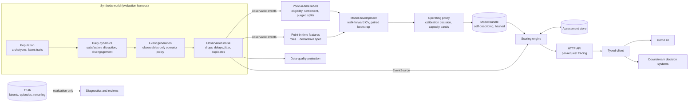

# Engagement Intelligence

A longitudinal engagement-risk service: it turns irregular, noisy behavioral event streams into
calibrated, explainable weekly assessments of the risk that an account disengages, and exposes
them through a typed API built for downstream decision systems.

The project demonstrates the full path from event simulation to a served model with an emphasis
on temporal correctness: point-in-time features and labels, leakage audits, purged walk-forward
validation, a one-time held-out evaluation, calibration under drift, and capacity-based operating
points.

> The synthetic environment is designed to evaluate system architecture and modeling methodology.
> It is not intended to estimate real-world prevalence, real behavior of any population, or
> production intervention thresholds.

## Results (held-out test split, evaluated once)

| Metric | Selected model | Recency baseline |
|---|---|---|
| Log loss | **0.244** | 0.282 |
| PR-AUC | **0.549** | 0.466 |
| ROC-AUC | **0.882** | 0.825 |
| Precision at 10% weekly review capacity | **0.584** | 0.531 |
| Recall at 10% weekly review capacity | **0.498** | 0.453 |
| Expected calibration error | 0.015 | 0.021 |

- Paired, account-clustered bootstrap difference in log loss (model minus baseline):
  **-0.038 [-0.045, -0.030]**.
- The baseline is a strong one: days since last engagement alone reaches ROC-AUC 0.82.
- The selected model is a regularized logistic regression on 15 point-in-time features. XGBoost
  was statistically equivalent on every feature set, so the simpler model was selected.
- Live scoring from raw events reproduces the offline predictions on all 31,715 held-out rows
  (maximum difference 5.6e-17).

Full reports: [`reports/day1_checkpoint.md`](reports/day1_checkpoint.md),
[`reports/model_comparison.md`](reports/model_comparison.md),
[`reports/model_review.md`](reports/model_review.md),
[`reports/test_evaluation.md`](reports/test_evaluation.md).

## What makes this different from a static churn model

A conventional churn project trains on one row per customer from an existing table and reports
a random-split score. This project treats engagement as a process unfolding in time:

| Concern | Static churn table | This project |
|---|---|---|
| Unit of prediction | One row per customer | One assessment per account per week |
| Information available | Whatever the table contains | Only events *recorded* by the assessment time |
| Late data | Ignored | Simulated recording delays; features and eligibility use recorded time |
| Label | Given | Defined, settled, censored, and audited against latent truth |
| Validation | Random split | Purged walk-forward CV within train; time-ordered validation; one-time test |
| Output | A score | A calibrated probability, risk band, band transition, capacity flag, and drivers |
| Consumption | A notebook | A versioned model bundle, a scoring engine, an HTTP API, and a typed client |

## Architecture



| Package | Responsibility | Depends on the simulator? |
|---|---|---|
| `core/` | Event envelope, vocabulary-as-data, roles, Arrow I/O, configuration, seeding, tracing | No (enforced by test) |
| `labels/` | Target specification, point-in-time eligibility and labels, purged splits | No (enforced by test) |
| `features/` | Declarative feature spec, point-in-time builder, truncation audit | No (enforced by test) |
| `evaluation/` | Metrics, capacity metrics, clustered bootstrap, slice tables | No |
| `models/` | Datasets, estimators, walk-forward tuning, comparison, operating policy, bundle, evaluation | No |
| `scoring/` | Assessment contract, event sources, assessment store, explainer, engine | No (enforced by test) |
| `service/` | FastAPI application factory, request/response models, observability | No (enforced by test) |
| `simulation/` | Synthetic world and truth-reading diagnostics | Is the simulator |
| `interop/` | Projection onto a data-quality detection system's record format | No |

## Synthetic world

Each account draws an archetype (seven, including sparse-but-stable accounts and false-alarm dips),
an arrival time, and six latent traits. A daily stepper evolves satisfaction, disruption episodes,
temporary dips, an engagement propensity, and an escapable disengaged state. A per-account
generator emits sessions, follow-ups, tasks, and message threads; an operator policy sends
reminders and nudges based only on past observable events. Observation noise then drops 3% of
events, delays 10% (lognormal, median 24 hours), jitters timestamps, and duplicates 0.5%.

Latent truth is written separately and read only by evaluation code. Details:
[`docs/SIMULATOR.md`](docs/SIMULATOR.md).

## Target and leakage prevention

- **Target.** An account assessed at time *t* is eligible if an engagement event *recorded by t*
  occurred in the previous 90 days. The label is a lapse if no engagement event *occurred* in the
  following 60 days. Labels become final after a 14-day settlement period; unsettled rows are
  censored, never labeled negative. These values are illustrative defaults supplied as
  configuration.
- **Splits.** Weekly assessments are assigned to train, validation, and test windows by date; rows
  whose label window reaches into the next window are purged.
- **Point-in-time guarantees.** Features and eligibility read only events with
  `recorded_at <= t`. A truncation audit rebuilds features from data cut at several dates and
  requires bit-for-bit equality; an injected leaky feature proves the audit catches violations.
- **Isolation.** Packages on the modeling path cannot import the simulator, and feature tables
  cannot contain label, split, or truth columns (enforced by tests).
- **Label quality.** Against latent truth, 85% of lapse labels are true disengagement, and labels
  capture 60% of latent-positive assessments. Both are measured, not removed.

## Features

Nineteen features in seven declarative kinds: recency, cadence-relative silence, windowed counts,
trajectory (log ratio of short- to long-window rates), smoothed rates, outstanding requests, and
tenure. Features reference roles (named groups of event types and actors) rather than raw event
types, so a different event vocabulary maps onto roles and reuses the specification unchanged.
Four features depend on the operator's outreach policy and are flagged; the selected model uses
none of them.

## Modeling and evaluation

- **Candidates:** recency baseline, logistic regression, XGBoost, each on three feature sets
  (all, without policy-dependent features, without trajectory features).
- **Tuning:** three purged expanding-window folds within train; grids extended until every
  optimum was interior.
- **Selection:** the simplest candidate not significantly worse than the best by validation log
  loss (paired, account-clustered bootstrap).
- **Findings:** every learned model beats the baseline; XGBoost is equivalent to logistic
  regression; policy-dependent features add nothing measurable; trajectory features add a small,
  significant gain for the linear model.
- **Calibration:** validation ECE 0.008 (no recalibration). On the test split, the model
  over-predicts slightly but uniformly (calibration slope 1.04), consistent with covariate shift
  as the simulated population ages.
- **Operating policy:** a HIGH band sized to a weekly review capacity (10% in the demo) and a
  MEDIUM band to a watch capacity (25%). Bands use fixed thresholds so that band transitions keep
  a stable meaning; a separate per-batch flag marks the accounts within review capacity.

## Assessment contract and service

Each assessment is a typed object:

```json
{
  "account_id": "acc_000200",
  "assessed_at": "2026-06-29T00:00:00Z",
  "status": "scored",
  "horizon_days": 60,
  "risk_score": 0.834,
  "risk_band": "high",
  "risk_change": {"transition": "unchanged", "previous_band": "high", "score_delta": 0.001},
  "within_review_capacity": true,
  "top_drivers": [
    {"feature": "days_since_engagement", "description": "Days since the last engagement event",
     "value": 59.66, "contribution": 1.07}
  ],
  "model_version": "lapse-60d-logistic-no-policy-198a1617fa"
}
```

| Endpoint | Purpose |
|---|---|
| `POST /assess` | Batch scoring at an as-of time; persists unless `persist=false` |
| `GET /accounts/{id}/assessment` | Single assessment; side-effect free |
| `GET /accounts/{id}/events` | Recent events known at the as-of time |
| `GET /accounts/{id}/risk-history` | Stored assessments |
| `GET /model-info`, `GET /health` | Bundle summary; liveness |

Every request writes one trace line (request id, route, arguments, model version, status,
latency, batch band shares). `top_drivers` are the factors raising risk relative to a typical
account; for low-risk accounts they do not explain the band.

**For downstream consumers:** about 14% of accounts change band in a typical week, mostly near
thresholds. A single-week transition is a noisy trigger; persistence or hysteresis rules belong
in the consuming decision layer.

## Configuration boundary

This repository is a reference implementation. The event vocabulary, roles, target definition,
feature specification, splits, and operating capacities are configuration in business units
(days, probabilities, shares of accounts). Core packages never depend on a specific vocabulary,
and the model bundle carries its target, roles, and feature specification, so a scorer needs
only a bundle and an event source.

## Reproducing the results

Requirements: Python 3.11 and [uv](https://docs.astral.sh/uv/).

```bash
uv sync
uv run pytest

# 1. Synthetic world, labels, and the Day-1 checkpoint
uv run python -m engagement_intelligence.simulation.cli --config configs/sim_reference.yaml --out data/reference

uv run python -m engagement_intelligence.labels.cli --events data/reference/observable/events.parquet --config configs/labeling_reference.yaml --roles configs/roles_reference.yaml --as-of 2026-07-01 --out data/reference/labels/assessments.parquet

uv run python -m engagement_intelligence.simulation.diagnostics --run data/reference --labeling-config configs/labeling_reference.yaml --roles configs/roles_reference.yaml --out reports/day1_checkpoint.md

# 2. Features, model development, review, bundle
uv run python -m engagement_intelligence.features.cli --events data/reference/observable/events.parquet --assessments data/reference/labels/assessments.parquet --roles configs/roles_reference.yaml --spec configs/features_reference.yaml --out data/reference/features/features.parquet

uv run python -m engagement_intelligence.models.cli --features data/reference/features/features.parquet --assessments data/reference/labels/assessments.parquet --labeling-config configs/labeling_reference.yaml --roles configs/roles_reference.yaml --feature-spec configs/features_reference.yaml --config configs/models_reference.yaml --report reports/model_comparison.md --record reports/experiments/model_comparison.json --artifacts artifacts/model_development

uv run python -m engagement_intelligence.simulation.model_review --run data/reference --labeling-config configs/labeling_reference.yaml --roles configs/roles_reference.yaml --operating configs/operating_reference.yaml --artifacts artifacts/model_development --record reports/experiments/model_comparison.json --report reports/model_review.md --out reports/experiments/operating_point.json

uv run python -m engagement_intelligence.models.bundle_cli --artifacts artifacts/model_development --point reports/experiments/operating_point.json --labeling-config configs/labeling_reference.yaml --roles configs/roles_reference.yaml --feature-spec configs/features_reference.yaml --config configs/models_reference.yaml --operating configs/operating_reference.yaml --out-dir artifacts/models

# 3. Scoring history, service, and demo UI
uv run python -m engagement_intelligence.scoring.backfill_cli --bundle artifacts/models/<model_version> --events data/reference/observable/events.parquet --store data/reference/scoring/assessments.jsonl --start 2025-12-01 --end 2026-07-01 --check-features data/reference/features/features.parquet --overwrite
EI_BUNDLE_DIR=artifacts/models/<model_version> EI_EVENTS_PATH=data/reference/observable/events.parquet \
EI_STORE_PATH=data/reference/scoring/assessments.jsonl EI_TRACE_PATH=data/reference/scoring/traces.jsonl \
EI_DEFAULT_AS_OF=2026-07-01T00:00:00+00:00 \

uv run uvicorn engagement_intelligence.service.app:create_app_from_env --factory
EI_API_URL=http://localhost:8000 EI_UI_AS_OF=2026-06-29 

uv run streamlit run app/streamlit_app.py
```

Every output carries the fingerprints of the configurations that produced it; downstream steps
refuse mismatched inputs. The held-out evaluation (`models.evaluate_cli`) is recorded once in
`reports/experiments/test_evaluation.json` and refuses to rerun without a recorded reason.

## Testing

205 tests cover determinism, point-in-time correctness, leakage audits, label and split rules,
metrics, model development guards, bundle integrity, end-to-end scoring consistency, the HTTP
service, and the typed client. Continuous integration runs the suite on Linux and Windows.

## Limitations

- All data are synthetic; absolute metrics describe the simulated world, not any real population.
- Early-lifecycle accounts are the main blind spot (cold-start recall 0.28 on the test split):
  training data contains no new accounts by construction.
- The model over-predicts slightly under population drift; production use would monitor
  calibration-in-the-large and periodically re-fit an intercept correction on matured labels.
- Driver attribution is exact for the linear model only; non-linear bundles raise rather than
  approximate.
- The JSON Lines assessment store and in-process locks suit a single-process demo, not concurrent
  production use. Model bundles use joblib and must be loaded only from trusted locations.

## Documentation

- [`docs/DECISIONS.md`](docs/DECISIONS.md): every design decision, experiment, and rejected
  hypothesis, in order.
- [`docs/SIMULATOR.md`](docs/SIMULATOR.md): the synthetic world and its validation.
- [`reports/`](reports/): checkpoint, comparison, review, and held-out evaluation reports.

## License

Copyright © 2026 José C Bozelli Jr. All rights reserved. This repository is published for
portfolio review; no license is granted to use, copy, modify, or distribute its contents.